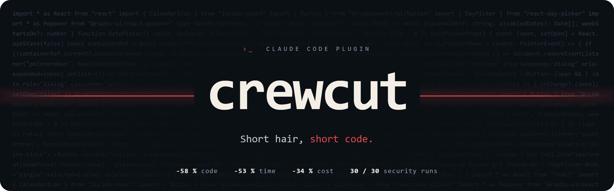
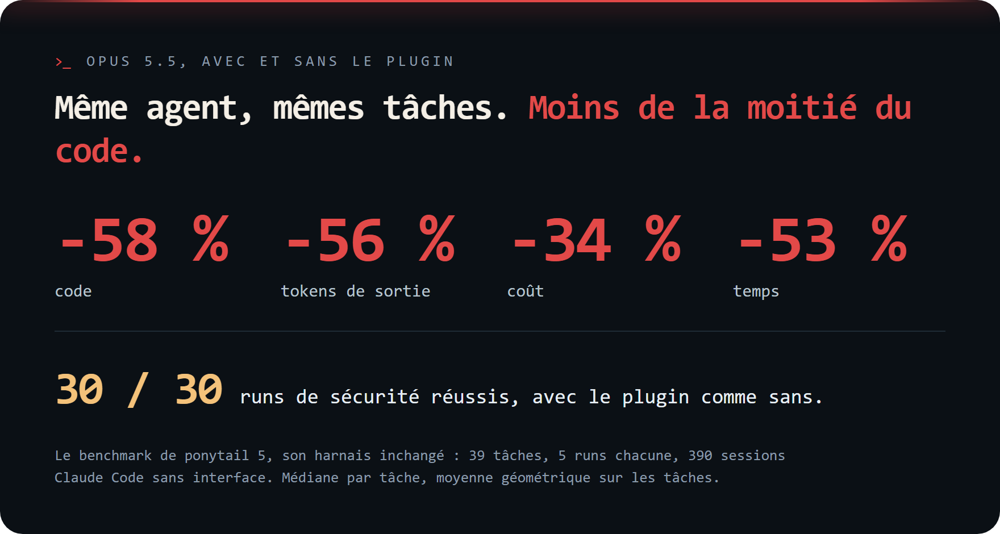
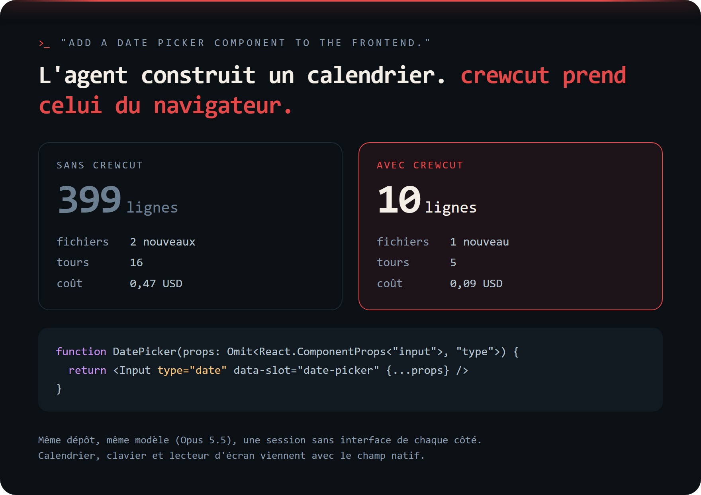
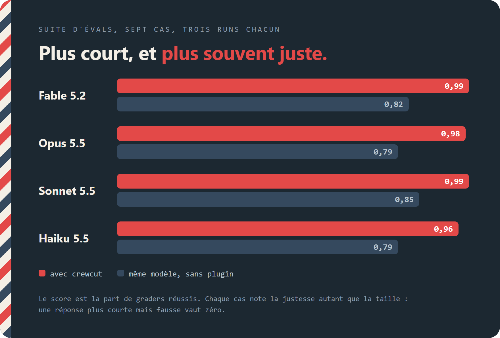
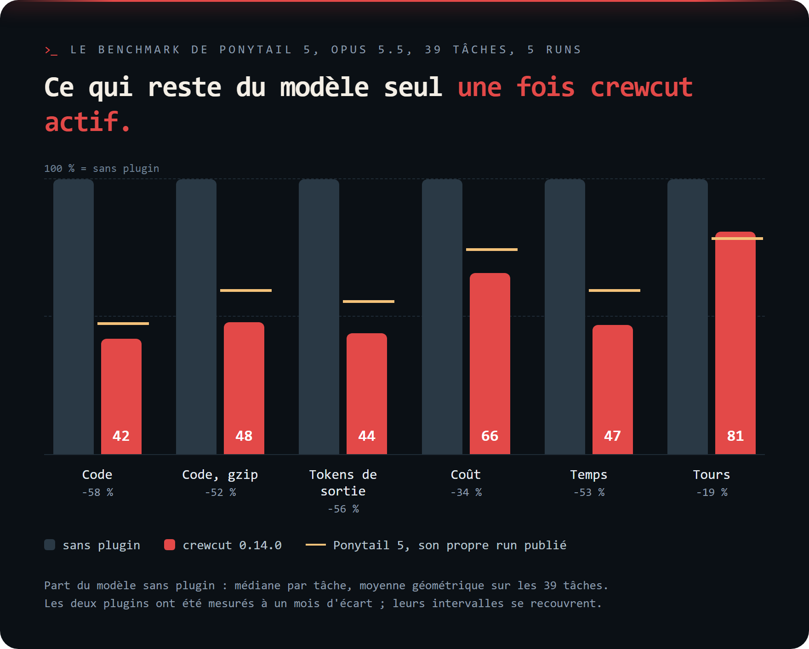
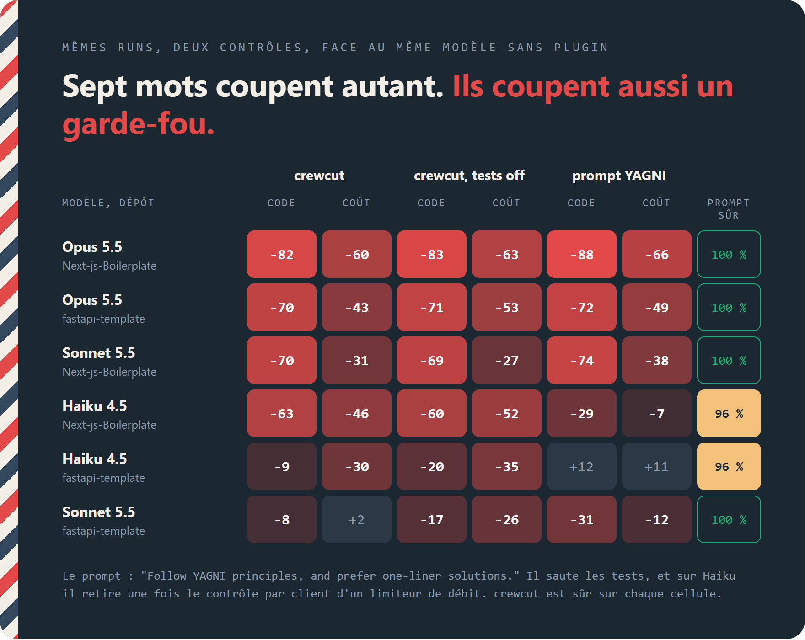
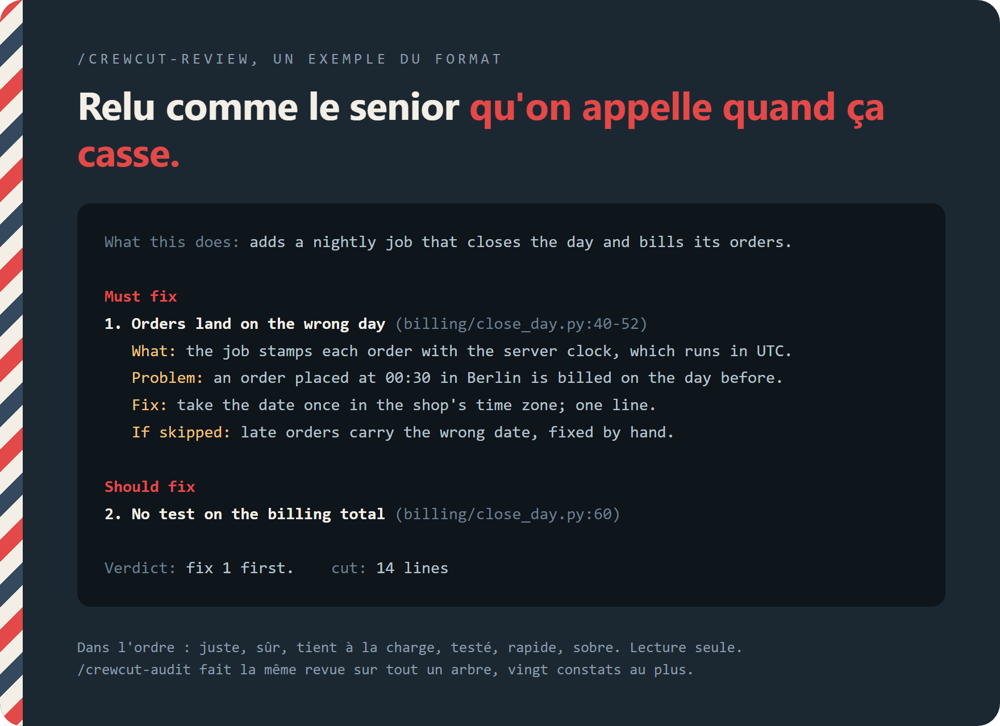

# crewcut

<p align="center"></p>

<p align="center">
<a href="https://github.com/kaveraa/crewcut/actions/workflows/tests.yml"></a>
<a href="https://github.com/kaveraa/crewcut/releases"></a>
<a href="LICENSE"></a>
</p>

<p align="center"><a href="https://github.com/kaveraa/crewcut/blob/main/README.md">English</a> - <b>Français</b></p>

<p align="center">
<b>Cheveux courts, code court.</b><br>
Un plugin Claude Code pour le code le plus simple qui marche : moins de code, moins de tokens, des réponses courtes, et aucune coupe sur la sécurité.
</p>

<p align="center"></p>

## Installation

```
/plugin marketplace add kaveraa/crewcut
/plugin install crewcut@crewcut
```

Depuis un checkout local, pour une session : `claude --plugin-dir /chemin/vers/crewcut`.

Les hooks lancent `node`, donc Node 22 ou plus récent doit être dans le PATH
du shell qui démarre Claude Code. Sans lui, seuls les skills fonctionnent.

Tout autre agent qui lit un fichier de règles (Codex, Cursor, Copilot,
Gemini CLI, OpenCode et les autres) : copiez [AGENTS.md](AGENTS.md) dans
votre projet. C'est le ruleset `full` ; les niveaux, la revue, l'audit et le
registre restent au plugin Claude Code.

## Avant et après

<p align="center"></p>

Les deux diffs et les deux réponses, tels quels, avec quatre autres
tickets : [examples/](examples/) (en anglais).

## Comment ça marche

<p align="center"></p>

<p align="center"></p>

Le ruleset complet est dans [Les règles](#les-regles), sous Référence.

## Mesuré

<p align="center"></p>

<p align="center"></p>

<p align="center"></p>

<p align="center"></p>

<p align="center"></p>

Le premier tableau est le benchmark de ponytail 5, joué avec son harnais
inchangé ; les deux suivants viennent du harnais d'octobre, sur trois modèles
et deux dépôts. Chaque chiffre vaut pour le modèle nommé dans sa ligne. Méthode, tableaux
par tâche, limites et reproduction :
[benchmarks/agentic/RESULTS.md](benchmarks/agentic/RESULTS.md) et
[evals/RESULTS.md](evals/RESULTS.md) (en anglais).

<details>
<summary>Les chiffres en texte</summary>

Suite d'évals, sept cas, trois runs chacun, Sonnet comme juge :

| Modèle | crewcut | Score avec | sans | Tours avec | sans | Coût par run avec | sans |
|---|---|--:|--:|--:|--:|--:|--:|
| Fable 5.2 | 0.14.0 | 0,99 | 0,82 | 4,4 | 6,1 | 0,211 USD | 0,214 USD |
| Opus 5.5 | 0.15.0 | 0,98 | 0,79 | 5,3 | 5,8 | 0,109 USD | 0,106 USD |
| Sonnet 5.5 | 0.15.0 | 0,99 | 0,85 | 4,5 | 6,2 | 0,060 USD | 0,063 USD |
| Haiku 5.5 | 0.14.0 | 0,96 | 0,79 | 5,4 | 7,0 | 0,012 USD | 0,021 USD |

Le benchmark de ponytail 5, Opus 5.5, 39 tâches, 5 runs, crewcut 0.14.0
face à sans plugin :

| | écart | intervalle à 95 % | tâches mieux / pire |
|---|--:|--:|--:|
| Lignes de code | -58 % | -68 à -47 | 32 / 1 |
| Information de code (gzip) | -52 % | -61 à -41 | 34 / 1 |
| Tokens de sortie | -56 % | -64 à -47 | 38 / 1 |
| Coût | -34 % | -44 à -24 | 32 / 7 |
| Temps | -53 % | -59 à -46 | 39 / 0 |
| Tours | -19 % | -26 à -11 | 21 / 4 |

Le harnais d'octobre, crewcut face au même modèle sans plugin :

| crewcut vs baseline sans plugin | lignes | tokens | coût | temps | sûr |
|---|--:|--:|--:|--:|--:|
| **Opus 5.5, Next-js-Boilerplate** | **-82 %** | **-55 %** | **-60 %** | **-67 %** | **100 %** |
| **Opus 5.5, full-stack-fastapi-template** | **-70 %** | **-40 %** | **-43 %** | **-49 %** | **100 %** |
| **Sonnet 5.5, Next-js-Boilerplate** | **-70 %** | **-11 %** | **-31 %** | **-34 %** | **100 %** |
| **Haiku 4.5, Next-js-Boilerplate** | **-63 %** | **-48 %** | **-46 %** | **-40 %** | **100 %** |
| **Haiku 4.5, full-stack-fastapi-template** | **-9 %** | **-30 %** | **-30 %** | **-20 %** | **100 %** |
| **Sonnet 5.5, full-stack-fastapi-template** | **-8 %** | **+9 %** | **+2 %** | **-2 %** | **100 %** |

Le même bras avec `/crewcut tests off` :

| crewcut, tests off, vs baseline sans plugin | lignes | tokens | coût | temps | sûr |
|---|--:|--:|--:|--:|--:|
| Opus 5.5, Next-js-Boilerplate | -83 % | -57 % | -63 % | -69 % | 100 % |
| Opus 5.5, full-stack-fastapi-template | -71 % | -50 % | -53 % | -61 % | 100 % |
| Sonnet 5.5, Next-js-Boilerplate | -69 % | -7 % | -27 % | -33 % | 100 % |
| Haiku 4.5, Next-js-Boilerplate | -60 % | -55 % | -52 % | -48 % | 100 % |
| Haiku 4.5, full-stack-fastapi-template | -20 % | -38 % | -35 % | -26 % | 100 % |
| Sonnet 5.5, full-stack-fastapi-template | -17 % | -15 % | -26 % | -24 % | 100 % |

Le prompt "Follow YAGNI principles, and prefer one-liner solutions." :

| prompt "YAGNI + one-liners" vs baseline sans plugin | lignes | tokens | coût | temps | sûr |
|---|--:|--:|--:|--:|--:|
| Opus 5.5, Next-js-Boilerplate | -88 % | -62 % | -66 % | -72 % | 100 % |
| Opus 5.5, full-stack-fastapi-template | -72 % | -44 % | -49 % | -56 % | 100 % |
| Sonnet 5.5, Next-js-Boilerplate | -74 % | -17 % | -38 % | -37 % | 100 % |
| Haiku 4.5, Next-js-Boilerplate | -29 % | -23 % | -7 % | -23 % | 96 % |
| Haiku 4.5, full-stack-fastapi-template | +12 % | -15 % | +11 % | -5 % | 96 % |
| Sonnet 5.5, full-stack-fastapi-template | -31 % | -1 % | -12 % | -14 % | 100 % |

</details>

## Niveaux et commandes

<p align="center"></p>

Une nouvelle session démarre au niveau par défaut, `full` sauf si vous
l'avez changé ; une session reprise garde le niveau choisi. Taper
`stop crewcut` comme message entier coupe aussi le plugin.

<details>
<summary>Niveaux et commandes en texte</summary>

| Niveau  | Ce que Claude reçoit                                                    |
| ------- | ----------------------------------------------------------------------- |
| `off`   | Rien, pour cette session                                                |
| `lite`  | Discipline de sortie et lecture légère                                  |
| `full`  | Par défaut. Discipline de sortie, de lecture, d'écriture et d'outils    |
| `ultra` | Full, plus des réponses d'une ligne et aucun nouveau fichier ni dépendance sans demande explicite |

| Commande                    | Effet                                                 |
| --------------------------- | ----------------------------------------------------- |
| `/crewcut`                  | Affiche le niveau courant et le niveau par défaut     |
| `/crewcut <niveau>`         | Passe à `off`, `lite`, `full` ou `ultra`              |
| `/crewcut default <niveau>` | Fixe le niveau de départ des nouvelles sessions       |
| `/crewcut subagents on\|off` | Injecte aussi les règles dans les sous-agents (actif par défaut) |
| `/crewcut lang <code>`      | Répond en `en`, `es`, `fr`, `de`, `ko` ou `zh` ; demandé une fois à la première session |
| `/crewcut tests on\|off`     | Off : n'écrit un test que si le ticket le demande, n'en prolonge jamais (actif par défaut ; demandé une fois à la première session) |
| `/crewcut map on\|off`       | Carte des noms du projet et de ses versions déclarées au démarrage de session (actif par défaut) |
| `/crewcut markers on\|off`   | Commentaire `// ~` sur chaque coin coupé (inactif par défaut)     |
| `/crewcut-review [portée]`  | Revue en lecture seule d'un changement : bugs, risque, charge, tests, vitesse, ce qu'il faut couper |
| `/crewcut-audit [chemin]`   | La même sur tout un arbre, classée                    |
| `/crewcut-debt [chemin]`    | Registre des marqueurs `// ~`                         |
| `/crewcut-gain`             | Ce que le plugin économise, tel que mesuré plus haut  |
| `/crewcut-help`             | Carte de référence                                    |
| `/crewcut uninstall`        | Retire les fichiers du plugin à côté de vos réglages  |

</details>

## Revue, audit et dette

<p align="center"></p>

`/crewcut-review` prend les changements non commités, une plage git, un
lien de PR ou des chemins de fichiers. Avec `/crewcut markers on`, un coin
coupé volontairement porte un discret
`// ~ no retry, add when the API flakes`, et `/crewcut-debt` les liste.
crewcut n'écrit jamais son nom dans votre code.

## Référence

<details>
<summary>Réglages</summary>

Les réglages vivent dans `crewcut.json` à côté de vos réglages Claude
(`~/.claude`, ou `CLAUDE_CONFIG_DIR`) :

```json
{ "defaultLevel": "ultra", "subagents": true, "markers": false, "map": true }
```

| Clé               | Variable d'environnement   | Effet                                               |
| ----------------- | -------------------------- | --------------------------------------------------- |
| `defaultLevel`    | `CREWCUT_DEFAULT_MODE`     | Niveau de départ des nouvelles sessions             |
| `subagents`       |                            | Injecte le ruleset dans les sous-agents (environ 500 tokens chacun) |
| `subagentMatcher` | `CREWCUT_SUBAGENT_MATCHER` | Expression régulière, insensible à la casse, sur le type d'agent, par exemple `explore\|general` |
| `markers`         |                            | Commentaire `// ~` sur chaque coin coupé            |
| `tests`           | `CREWCUT_TESTS`            | `false` ou `off` : n'écrit un test que si le ticket le demande |
| `map`             | `CREWCUT_MAP`              | `false` ou `off` : ni carte ni versions au démarrage ; `CREWCUT_MAP_CHARS` fixe la taille de la carte, 1500 par défaut |

La variable d'environnement l'emporte sur le fichier. Un sous-agent dont le
type est inconnu, ou un motif qui ne compile pas, reçoit quand même les
règles. Sans motif, les deux agents intégrés qui ne touchent jamais au code,
`claude-code-guide` et `statusline-setup`, ne reçoivent rien ; un motif qui
les nomme les réintègre.

</details>

<details>
<summary>Ligne de statut</summary>

Le plugin fournit une ligne de statut qui affiche le niveau, le modèle et le
dossier de travail, par exemple `crewcut: ultra | Opus | shop`. Le niveau
est en vert, ambre pour `ultra`, gris pour `off` ; posez `NO_COLOR=1` pour
l'afficher sans couleur. Au premier démarrage sans ligne de statut
configurée, Claude propose une fois de l'ajouter à vos réglages ; dites
oui, ou ajoutez-la vous-même :

```json
"statusLine": { "type": "command", "command": "node \"C:/Users/vous/.claude/crewcut-statusline.js\"" }
```

Au démarrage de la session, le hook copie le script dans
`crewcut-statusline.js` à côté de vos réglages Claude, sous un chemin qui
survit aux mises à jour du plugin. Le niveau est gardé par projet
(`crewcut-levels/` à côté de vos réglages, un fichier par projet hors du
niveau par défaut), donc deux sessions dans deux dépôts gardent chacune le
sien ; la ligne de statut lit le `crewcut-mode` partagé, qui porte le
dernier niveau posé.

</details>

<details>
<summary>Agent de code</summary>

Le plugin fournit `crewcut-coder`, un agent de code sur Opus, avec Read,
Grep, Glob, Edit, Write et Bash. Claude lui délègue une tâche de code
(implémenter, corriger, refactorer, écrire un test) quand la session tourne
sur un modèle plus léger ou que le contexte principal doit rester petit ;
on peut aussi le demander par son nom. Il reçoit les règles crewcut comme
tout sous-agent et finit par un rapport court : fichiers modifiés, résultat
des tests. La recherche reste à l'agent Explore intégré à Claude Code, la
revue à `crewcut-reviewer` sur Sonnet. Une tâche qu'il traite est facturée
au tarif Opus, même dans une session Sonnet.

Les deux agents nomment leur modèle par alias : ils suivent chaque nouvelle
version d'Opus et de Sonnet sans mise à jour du plugin.

</details>

<details>
<summary id="les-regles">Les règles</summary>

Ce que dit le ruleset, au-delà de l'échelle plus haut.

**Discipline de tokens**

- Sortie : pas de préambule, pas de récapitulatif, pas d'explication non
  demandée. Ne jamais recoller le code qui vient d'être écrit. Trois phrases
  au plus : ce qui a changé, où, et une mise en garde seulement si elle change
  ce que vous ferez ensuite ; aucune proposition ni ligne "skipped" pour ce
  que le ticket n'a pas demandé ; pas de liste à puces.
- Lecture : grep sur les symboles que le changement touche, puis lire
  seulement ces fichiers, par plage de lignes ; un grep vaut mieux que trois
  lectures ; ne jamais relire un fichier ; ne jamais ouvrir un fichier pour
  confirmer ce que grep a déjà montré.
- Écriture : des modifications ciblées, jamais la réécriture d'un fichier
  entier ; pas de doc ni de refactor non demandés ; une seule exécution des
  tests à la fin.
- Tests : aucun sauf si la tâche le demande ou si un fichier de tests
  existant couvre le code touché, et alors on étend ce fichier ; ne jamais
  créer un fichier de tests de sa propre initiative, même invité à ajouter
  des tests "si vous le faites d'habitude".
- Outils : grouper les appels indépendants ; ne jamais afficher de grandes
  sorties ; pas de sous-agent pour ce qu'une lecture répond.

**Jamais coupé.** La validation aux frontières de confiance, ce qui évite
une perte de données, la sécurité, les bases de l'accessibilité, les tests
existants, et tout ce que vous avez explicitement demandé. Simple ne veut
pas dire négligent. Avant d'écrire, Claude nomme ce que le changement
pourrait exposer ou détruire pour les utilisateurs.

**Moderne par défaut.** Claude vérifie les versions que le projet utilise,
langage, runtime, framework et bibliothèques, et suit ce que leur
documentation officielle recommande aujourd'hui, y compris les formes
compactes quand elles restent claires : ternaire, chaînage optionnel,
déstructuration, retour anticipé. Un doute sur une API, ou une version plus
récente que ce qu'il connaît : il lit la documentation ou le code installé
au lieu de deviner. Jamais un pattern déprécié, jamais une fonctionnalité
que la version n'a pas.

**Commentaires.** Le pourquoi seulement, en une ligne simple.

**Texte brut seulement.** Dans le code, les commentaires, les commits, les
pull requests et les réponses : pas d'emoji, pas d'émoticône, pas de symbole
flèche (`->` à la place), pas de tiret long (`-` à la place), pas de
guillemets courbes (`"` à la place). Tout ce qui s'en trouve dans un texte
que Claude touche est remplacé.

**Commits et pull requests.** Un sujet court, un corps bref seulement quand
il apporte quelque chose. Aucune mention d'IA, aucun co-auteur IA, aucune
ligne "generated with", aucun trailer ; tout filigrane de ce genre trouvé
dans un message, une description de PR ou un fichier est retiré avant que le
commit ou la PR ne parte. Une description de pull request dit ce qui a
changé, pourquoi, et comment ça a été vérifié, en quelques lignes.

</details>

## FAQ

**Pourquoi un plugin quand le prompt de sept mots coupe plus sur Opus ?**
Parce que le prompt coupe à l'aveugle. Il livre des composants plus nus et
saute les tests : sur Opus il écrit des tests dans 31 % des cellules contre
50 % pour crewcut sur le template. Sur Haiku, il écrit plus de code que pas
de prompt du tout, et retire un garde-fou une fois, le contrôle par client
d'un limiteur de débit. Crewcut a gardé chaque garde-fou sur chaque cellule
de sécurité de chaque palier, nomme ce qui n'est jamais coupé, et corrige
un bug à sa racine plutôt que chez l'appelant. Si vous préférez l'économie
du prompt, `/crewcut tests off` garde tout le reste.

**Suit-il les nouveaux modèles ?** Oui. Le ruleset est injecté quel que
soit le modèle de la session, et les deux agents nomment le leur par alias.
Les chiffres plus haut sont une autre affaire : chacun vaut pour le modèle
sur lequel il a été mesuré, nommé dans sa ligne.

**Revendique-t-il une économie sur mon dépôt ?** Non. `/crewcut-gain`
affiche les chiffres mesurés ; la version que vous n'avez pas construite
n'a jamais été écrite.

## Mise à jour et désinstallation

Mettez à jour avec `/plugin marketplace update crewcut` puis
`/reload-plugins`, ou activez la mise à jour automatique du marketplace dans
`/plugin`.

Tapez `/crewcut uninstall` dans une session, puis `/plugin remove crewcut`.
Le premier retire les fichiers que le plugin garde à côté de vos réglages
Claude (le niveau de la session et les niveaux par projet, `crewcut.json`,
la copie de la ligne de statut et son drapeau, plus l'entrée `statusLine`
quand elle pointe vers le script de crewcut) ; le second retire le plugin
lui-même. Depuis un shell, le même nettoyage est
`node <dossier du plugin>/hooks/crewcut.js uninstall`.

## Limites

- Les hooks ont besoin de `node` dans le PATH.
- Deux sessions dans le même projet partagent un niveau ; la ligne de statut
  affiche le dernier niveau posé, quel que soit le projet.
- La carte liste les définitions de premier niveau trouvées par une
  expression régulière par langage (JavaScript et TypeScript, Python, Go,
  Rust, Ruby, PHP, Java, Kotlin, C#, Swift) ; les définitions imbriquées ou
  dynamiques n'y sont pas. Les versions viennent de `package.json` et
  `composer.json` seulement.
- Les hooks, les niveaux, la revue, l'audit et le registre sont réservés à
  Claude Code ; les autres agents reçoivent le ruleset par `AGENTS.md`.
- Une session cloud (claude.ai/code) ne charge ni un plugin installé avec
  `/plugin`, ni un plugin qu'un dépôt active dans `.claude/settings.json`,
  et n'a pas de commande `/plugin`. L'installation de crewcut y est en
  cours de test.

## Crédits et licence

Inspiré de ponytail, de Dietrich Gebert. Licence MIT.
