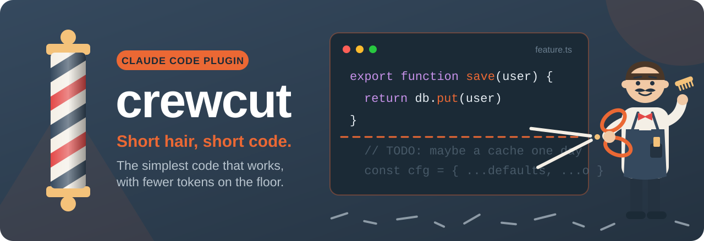
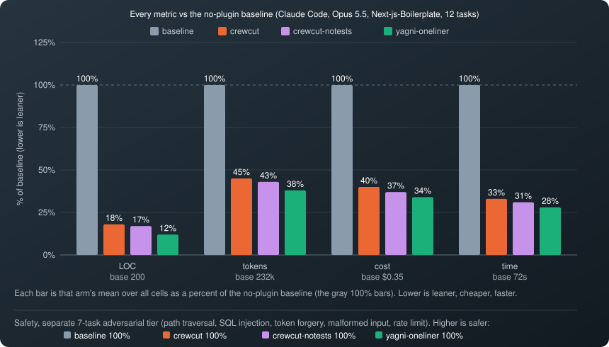
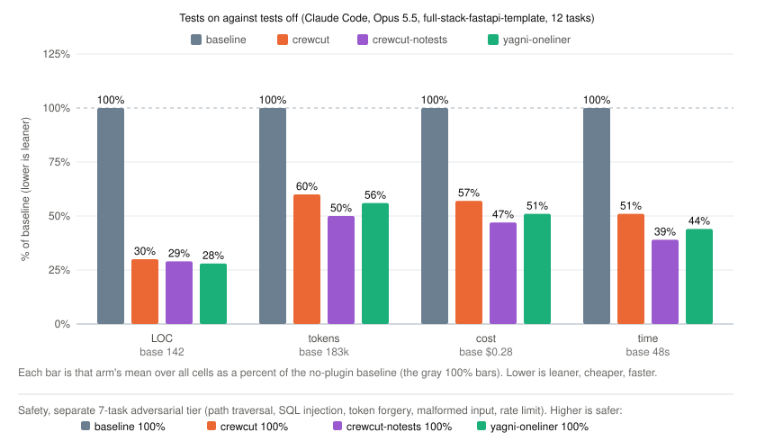

# crewcut

<p align="center"></p>

<p align="center">
<a href="https://github.com/kaveraa/crewcut/actions/workflows/tests.yml"></a>
<a href="https://github.com/kaveraa/crewcut/releases"></a>
<a href="LICENSE"></a>
</p>

<p align="center"><b>English</b> - <a href="https://github.com/kaveraa/crewcut/blob/main/README.fr.md">Français</a></p>

Short hair, short code. A Claude Code plugin for the simplest code that
works: less code, fewer tokens, short answers, and no cut on safety.

> **On Opus 5.5, up to 82 % less code and 60 % lower cost** than the same
> model without the plugin, every safety check kept. Measured with the
> benchmark ponytail published for itself.

## Install

```
/plugin marketplace add kaveraa/crewcut
/plugin install crewcut@crewcut
```

From a local checkout, for one session: `claude --plugin-dir /path/to/crewcut`.

The hooks run `node`, so Node 22 or newer must be on the PATH of the shell
that starts Claude Code. Without it, only the skills work.

Any other agent that reads a rules file (Codex, Cursor, Copilot, Gemini
CLI, OpenCode and the rest): copy [AGENTS.md](AGENTS.md) into your project.
It is the `full` ruleset; the levels, the review, the audit and the ledger
stay with the Claude Code plugin.

## Before and after

Ticket: "Add a date picker component to the frontend." Same repository,
same model (Opus 5.5), one headless Claude Code session each.

| | Without crewcut | With crewcut |
|---|---|---|
| Lines added | 318 | 10 |
| New packages | 2 (`react-day-picker`, `@radix-ui/react-popover`) | 0 |
| Turns | 14 | 5 |
| Cost | 0.37 USD | 0.11 USD |

Without the plugin, Opus installs a calendar and a popover, writes a wrapper
component, a stylesheet and a usage page, and tells you to run `bun install`.
With it:

```tsx
import type * as React from "react"

import { Input } from "@/components/ui/input"

// crewcut: native <input type="date"> gives the calendar popup, keyboard and screen reader support for free
function DatePicker(props: Omit<React.ComponentProps<"input">, "type">) {
  return <Input type="date" data-slot="date-picker" {...props} />
}

export { DatePicker }
```

The reply says what it wraps, that it works with `react-hook-form` like the
other inputs, that nothing was run, and that the styled calendar would cost
two packages if you want it. Both diffs and both replies, verbatim, with
four other tickets: [examples/](examples/).

## How it works

At session start, and in every subagent, Claude receives one ruleset: a
senior who reads everything and writes almost nothing. For every piece of
code, it takes the lowest rung that holds:

1. Needs to exist at all? If not, skip it and say so in one line.
2. Already in this codebase? Reuse it.
3. Standard library does it? Use it.
4. Platform does it natively (HTML, CSS, SQL, OS)? Use it.
5. An installed dependency does it? Use it. Never add one for what a few lines do.
6. One line? One line.
7. Only then: the minimum that works.

**Build the ticket, not its neighbours.** No optional prop, state, mode,
setting or edge case the ticket did not name. A second use case is a second
ticket. No type alias or helper for a single use.

**Bug fix means root cause.** Find every caller, fix the shared function
once, even when the other callers look safe today.

**Never cut.** Validation at trust boundaries, handling that prevents data
loss, security, accessibility basics, existing tests, and anything you
explicitly asked for. Simple is not negligent.

**Short never means wrong.** A question gets a full answer, a failing test
is fixed and rerun, a file that changed since the last read is read again.
Fewer tokens is the goal only when the answer stays right.

**The map.** With the ruleset, the session start carries a map of what
the project already defines: one line per folder with its exported
functions, classes and constants, tests and vendored code left out, about
1 500 characters at most. "Already in this codebase? Reuse it" then costs
no search, and the model does not rebuild a helper that exists two folders
away. One more line gives the versions that `package.json` and
`composer.json` declare, 400 characters at most, so the model writes for
the versions in use without reading a manifest. `/crewcut map off` drops
both.

The full ruleset is in [The rules](#the-rules) below.

## Benchmark

Crewcut run through the benchmark ponytail published for itself: twelve
one-line tickets against a real repository, a headless Claude Code session
per cell, scored on the `git diff` it leaves behind, with the same controls
(caveman for terse prose, the seven-word YAGNI prompt) and seven safety
tasks whose output is executed against adversarial input. Two repositories,
full-stack-fastapi-template (ponytail's own, FastAPI + React) and
Next-js-Boilerplate, three model tiers, three or four runs per cell. Each
cell is the arm's mean over all cells as a percent of the same model with
no plugin; the Haiku rows are the crewcut 0.11.3 re-measure against that
run's baseline, the version of every other cell is in RESULTS.md.

| crewcut vs no-plugin baseline | LOC | tokens | cost | time | safe |
|---|--:|--:|--:|--:|--:|
| **Opus 5.5, Next-js-Boilerplate** | **-82 %** | **-55 %** | **-60 %** | **-67 %** | **100 %** |
| **Opus 5.5, full-stack-fastapi-template** | **-70 %** | **-40 %** | **-43 %** | **-49 %** | **100 %** |
| **Sonnet 5.5, Next-js-Boilerplate** | **-70 %** | **-11 %** | **-31 %** | **-34 %** | **100 %** |
| **Haiku 4.5, Next-js-Boilerplate** | **-63 %** | **-48 %** | **-46 %** | **-40 %** | **100 %** |
| **Haiku 4.5, full-stack-fastapi-template** | **-9 %** | **-30 %** | **-30 %** | **-20 %** | **100 %** |
| **Sonnet 5.5, full-stack-fastapi-template** | **-8 %** | **+9 %** | **+2 %** | **-2 %** | **100 %** |

The same arm with `/crewcut tests off`, a test only when the ticket asks:

| crewcut, tests off, vs no-plugin baseline | LOC | tokens | cost | time | safe |
|---|--:|--:|--:|--:|--:|
| Opus 5.5, Next-js-Boilerplate | -83 % | -57 % | -63 % | -69 % | 100 % |
| Opus 5.5, full-stack-fastapi-template | -71 % | -50 % | -53 % | -61 % | 100 % |
| Sonnet 5.5, Next-js-Boilerplate | -69 % | -7 % | -27 % | -33 % | 100 % |
| Haiku 4.5, Next-js-Boilerplate | -60 % | -55 % | -52 % | -48 % | 100 % |
| Haiku 4.5, full-stack-fastapi-template | -20 % | -38 % | -35 % | -26 % | 100 % |
| Sonnet 5.5, full-stack-fastapi-template | -17 % | -15 % | -26 % | -24 % | 100 % |

<p align="center"></p>

The seven-word prompt "Follow YAGNI principles, and prefer one-liner
solutions." in the same runs:

| "YAGNI + one-liners" prompt vs no-plugin baseline | LOC | tokens | cost | time | safe |
|---|--:|--:|--:|--:|--:|
| Opus 5.5, Next-js-Boilerplate | -88 % | -62 % | -66 % | -72 % | 100 % |
| Opus 5.5, full-stack-fastapi-template | -72 % | -44 % | -49 % | -56 % | 100 % |
| Sonnet 5.5, Next-js-Boilerplate | -74 % | -17 % | -38 % | -37 % | 100 % |
| Haiku 4.5, Next-js-Boilerplate | -29 % | -23 % | -7 % | -23 % | 96 % |
| Haiku 4.5, full-stack-fastapi-template | +12 % | -15 % | +11 % | -5 % | 96 % |
| Sonnet 5.5, full-stack-fastapi-template | -31 % | -1 % | -12 % | -14 % | 100 % |

**Why a plugin when seven words cut more on Opus?** Because the prompt cuts
blind.

- It ships barer components, and it skips the tests: on Opus it writes
  tests in 31 % of the cells against 50 % for crewcut on the template, and
  in none against 19 % on the boilerplate; on Sonnet, 22 % against 50 %.
  The harness counts test files apart from LOC, so those tests are where
  crewcut's extra turns and cost go, not its lines. Every crewcut test
  extends a test file the repository already had.
- On Haiku it writes more code than no prompt at all, and once drops a
  guard, the per-client check of a rate limiter. Crewcut kept every guard on
  every safety cell of every tier.
- The ruleset names what never gets cut, fixes a bug at its root rather
  than at the caller, and ships with levels, a review, an audit and a debt
  ledger.

Caveman, the terse-prose control, cuts no code (+4 % LOC on the template):
short prose is not short code.

If you would rather have the prompt's savings, `/crewcut tests off` makes
crewcut write a test only when the ticket asks and keeps everything else.
Measured on every tier (second table above): on the Opus template, tokens
go from -40 % to -50 % and cost from -43 % to -53 %; on Sonnet's template,
from +9 % to -15 % and +2 % to -26 %, under the prompt on both; on Haiku,
cost from -30 % to -35 % on the template and -46 % to -52 % on Next.js.
Lines barely move, every cell stays correct, every guard stays. Where there is no
test file to extend, Opus and Sonnet on Next.js, the switch changes nothing.
The first session asks you once which you want.

<p align="center"></p>

The cut is biggest where a native element replaces a component: on the date
picker, Opus writes 369 lines with two new dependencies, crewcut a 10-line
native input. It is near zero on irreducible endpoints, and it follows how
much the baseline over-builds, which depends on the repository as much as
on the model: Sonnet writes 51 lines per ticket on the small FastAPI
template and 103 on Next-js-Boilerplate, so crewcut cuts 8 % there and
70 % here. On the template the ruleset read back on every turn is the whole
cost; crewcut 0.6.3, with a lighter ruleset and six runs per ticket, cuts
13 % of the lines and 11 % of the cost there at equal tokens. Tokens fall
only where the plugin removes turns: on Opus, from 12.1 to 7.5 per ticket;
on Sonnet with Next.js, from 10.4 to 6.8.

Method, per-task tables, the re-measure of each version, limits and how to
reproduce: [benchmarks/agentic/RESULTS.md](benchmarks/agentic/RESULTS.md).
Five cells with the diff and the reply of each arm, verbatim:
[examples/](examples/).

## Eval suite

The plugin's own seven cases, three runs each, with and without the
plugin, Sonnet as judge
(`claude plugin eval . --ablation with-without --runs 3 --judge-model sonnet`,
with `--allow-tools Edit Write`). Score is the share of graders passed;
every case grades correctness as well as size, so a shorter answer that is
wrong scores zero. Latest measure on each working model (Claude Code
2.1.289 for Fable, 2.1.323 for the others):

| Model | crewcut | Score with | without | Turns with | without | Cost per run with | without |
|---|---|--:|--:|--:|--:|--:|--:|
| Fable 5.1 | 0.7.0 | 0.98 | 0.81 | 5.7 | 8.4 | 0.296 USD | 0.414 USD |
| Sonnet 5.5 | 0.13.0 | 0.99 | 0.87 | 4.5 | 6.0 | 0.057 USD | 0.057 USD |
| Opus 5.5 | 0.13.0 | 1.00 | 0.81 | 5.2 | 5.6 | 0.106 USD | 0.101 USD |

- The savings grow with the project. `csv-export` is twenty source and
  test files with a one-line bug: with the plugin, Fable reads 3.3 files
  against 9.0, and `vat-country`, seven modules, 3.0 against 11.0. The
  one-file cases have nothing to cut, and the ruleset is a fixed cost there.
- The map, measured the same day with and without it on both models, changes
  nothing beyond noise on cases this small: Sonnet reads 1.0 file against
  1.3 on `vat-country` and the totals stay within two points. Its case is
  the repository of hundreds of files, which the agentic benchmark will
  measure.
- `shared-bug` is fixed in the shared function in 3 runs out of 3 with the
  plugin on all three models, 0 without: every run without it patched the
  caller.
- `keep-validation` asks to simplify a handler at a trust boundary and fails
  if any check disappears: without the plugin, Fable and Opus dropped a
  check or overstated what they kept. `explain-bug` fails if the explanation
  is cut short; `vat-country` and `csv-export` fail if an existing test or
  an untouched module changes.

Per-case tables and the re-measure of each version:
[evals/RESULTS.md](evals/RESULTS.md).

## Levels

| Level   | What Claude gets                                                        |
| ------- | ----------------------------------------------------------------------- |
| `off`   | Nothing, for this session                                               |
| `lite`  | Output discipline and a light reading habit                             |
| `full`  | Default. Output, reading, writing and tool discipline                   |
| `ultra` | Full, plus one-line answers and no new file or dependency without an explicit request |

A new session starts at the default level, `full` unless you changed it; a
resumed session and a context compaction keep the level you chose. Typing
`stop crewcut` or `normal mode` as a whole message also switches the plugin
off.

## Commands

| Command                     | Effect                                                |
| --------------------------- | ----------------------------------------------------- |
| `/crewcut`                  | Show the current level and the default                |
| `/crewcut <level>`          | Switch to `off`, `lite`, `full` or `ultra`            |
| `/crewcut default <level>`  | Set the level new sessions start at                   |
| `/crewcut subagents on\|off` | Inject the rules into subagents too (on by default)   |
| `/crewcut lang <code>`      | Reply in `en`, `es`, `fr`, `de`, `ko` or `zh`; asked once at the first session |
| `/crewcut markers on\|off`   | `// ~` comment on each corner cut (off by default)     |
| `/crewcut tests on\|off`     | Off: write a test only when the ticket asks, never extend one (on by default; asked once at the first session) |
| `/crewcut map on\|off`       | Map of the project's own names at session start, so reuse costs no search (on by default) |
| `/crewcut-review [scope]`   | Read-only review of a change: bugs, risk, load, tests, speed, what to cut |
| `/crewcut-audit [path]`     | The same over a whole tree, ranked                    |
| `/crewcut-debt [path]`      | Ledger of the `// ~` markers                          |
| `/crewcut-gain`             | What the plugin saves, as measured above              |
| `/crewcut-help`             | Reference card                                        |
| `/crewcut uninstall`        | Remove the plugin's files next to your settings       |

### Review, audit and debt

`/crewcut-review` reviews the uncommitted changes, or the last commit when
there are none; `/crewcut-review main..HEAD`, a PR link or
`/crewcut-review src/a.js src/b.js` sets the scope. A read-only agent on
Sonnet reads the diff and the code it touches, callers included, and
reviews it like the senior who gets paged when it breaks, in this order:
correct, safe, holds at the load the project expects, tested, fast, lean.
Every finding comes with a concrete case, the smallest fix and what happens
if it is skipped, in plain words, grouped as must fix, should fix and nice
to have, numbered so you can say "fix 2 and 4":

```
What this does: adds a nightly job that closes the day and bills its orders.

Must fix
1. Orders land on the wrong day (billing/close_day.py:40-52)
   What: the job stamps each order with the server clock, which runs in UTC.
   Problem: an order placed at 00:30 in Berlin is billed on the day before.
   Fix: take the date once in the shop's time zone; one line, nothing else moves.
   If skipped: late orders carry the wrong date and accounting corrects them by hand.

Should fix
2. No test on the billing total (billing/close_day.py:60)
   ...

Verdict: fix 1 first.
cut: 14 lines
```

Lean findings still name the rung where the code should have stopped
(`skip`, `reuse`, `stdlib`, `native`, `installed`, `one-line`, `merge`,
`split`, `prose`) and the last line counts the lines they would remove. A
`~` marker that names its limit is a decision, not a finding, unless
the expected load already crosses it. `/crewcut-audit` runs the same review
over a whole tree, entry points and main flows first, twenty findings at
most. Both report and change nothing; the level stays as it was.

With `/crewcut markers on`, every corner crewcut cuts on purpose carries a
comment such as `// ~ no retry, add when the API flakes`, never as
a prefix on a comment that explains code. Markers are off by default: on a
real project the models put the prefix on ordinary comments too. The sign
is discreet: crewcut never writes its name in your code, and every other
comment says why, in one plain line.
`/crewcut-debt` gathers the markers into one list and flags those that name
no condition to revisit:

```
src/queue.js:18: no retry -> add when: the API flakes
src/report.js:40: full table scan -> no trigger
2 markers, 1 without a trigger
```

`/crewcut-gain` prints the figures above as a card. It never claims a saving
on your repository, since the version you did not build was never written.

### Code agent

The plugin ships `crewcut-coder`, a code agent pinned to Opus with Read,
Grep, Glob, Edit, Write and Bash. Claude delegates a code task to it
(implement, fix, refactor, write a test) when the session runs on a lighter
model or the main context should stay small; you can also ask for it by
name. It gets the crewcut rules like any subagent and ends with a short
report: files changed, test result. Search stays with Claude Code's
built-in Explore agent, review with `crewcut-reviewer` on Sonnet. A task it
handles is billed at Opus rates, even in a Sonnet session.

## Status line

The plugin ships a status line that prints the level, the model and the
working directory, for example `crewcut: ultra | Opus | shop`. The level is
green, amber for `ultra`, grey for `off`; set
`NO_COLOR=1` to print it plain. On the first start without a status line
configured, Claude offers once to add it to your settings; say yes, or add
it yourself:

```json
"statusLine": { "type": "command", "command": "node \"C:/Users/you/.claude/crewcut-statusline.js\"" }
```

At session start the hook copies the script to `crewcut-statusline.js` next
to your Claude settings, under a path that survives plugin updates, and
refreshes the copy when the plugin changes. The level is kept per project
(`crewcut-levels/` next to your settings, one file per project off the default),
so two sessions in two repositories keep their own; the status line reads
the shared `crewcut-mode`, which carries the level set last.

## Settings

Settings live in `crewcut.json` next to your Claude settings (`~/.claude`,
or `CLAUDE_CONFIG_DIR`):

```json
{ "defaultLevel": "ultra", "subagents": true, "markers": false, "map": true }
```

| Key               | Environment variable      | Effect                                              |
| ----------------- | ------------------------- | --------------------------------------------------- |
| `defaultLevel`    | `CREWCUT_DEFAULT_MODE`    | Level new sessions start at                         |
| `subagents`       |                           | Inject the ruleset into subagents (about 500 tokens each) |
| `subagentMatcher` | `CREWCUT_SUBAGENT_MATCHER` | Case-insensitive regular expression on the agent type, for example `explore\|general` |
| `markers`         |                           | `// ~` comment on each corner cut                   |
| `tests`           | `CREWCUT_TESTS`           | `false` or `off`: write a test only when the ticket asks |
| `map`             | `CREWCUT_MAP`             | `false` or `off`: no map of the project's names at session start; `CREWCUT_MAP_CHARS` sets its size, 1500 by default |

The environment variable wins over the file. A subagent whose type is
unknown, or a pattern that does not compile, still receives the rules.
Without a pattern, the two built-in agents that never touch code,
`claude-code-guide` and `statusline-setup`, receive nothing; a pattern that
names them brings them back.

## The rules

What the ruleset says, beyond the ladder above.

**Token discipline**

- Output: no preamble, no recap, no unrequested explanation. Never paste
  back code just written. Three sentences at most: what changed, where, and
  one caveat only if it changes what you do next; no offer and no "skipped"
  line for what the ticket never asked; no bullet list.
- Reading: grep for the symbols the change touches, then read only those
  files, by line range; one grep beats three reads; never read a file twice;
  never open a file to confirm what grep already showed.
- Writing: targeted edits, never a whole-file rewrite; no unrequested docs or
  refactors; one test run at the end.
- Tests: none unless the task asks or an existing test file covers the
  touched code, then extend that file; never create a test file on your own,
  even when invited to add tests "if you normally would".
- Tools: batch independent calls; never print large outputs; no subagent for
  what one read answers.

**Modern by default.** Claude checks the versions the project runs,
language, runtime, framework and libraries, and follows what their official
docs recommend today, including the compact forms when they stay clear:
ternary, optional chaining, destructuring, early return. Unsure of an API,
or a version newer than it knows: it reads the docs or the installed source
instead of guessing. Never a deprecated pattern, never a feature the version
lacks.

**Plain text only.** In code, comments, commits, pull requests and answers:
no emoji, no emoticon, no arrow symbol (`->` instead), no long dash (`-`
instead), no curly quotes (`"` instead). Any found in text Claude touches is
replaced.

**Commits and pull requests.** One short subject line, a brief body only
when it adds something. No AI mention, no AI co-author, no generated-with
line, no trailer; any such watermark found in a message, a PR description
or a file is removed before the commit or the PR goes out. A pull request
description says what changed, why, and how it was checked, in a few lines.

## Update and uninstall

Update with `/plugin marketplace update crewcut` then `/reload-plugins`, or
enable auto-update for the marketplace in `/plugin`.

Type `/crewcut uninstall` in a session, then `/plugin remove crewcut`. The
first removes the files the plugin keeps next to your Claude settings (the
session level and the per-project levels, `crewcut.json`, the status line copy and its flag, plus the
`statusLine` entry when it points at crewcut's own script); the second
removes the plugin itself. From a shell, the same cleanup is
`node <plugin dir>/hooks/crewcut.js uninstall`.

## Limitations

- The hooks need `node` on the PATH.
- Two sessions in the same project share one level; the status line shows
  the level set last, whatever the project.
- The map lists top-level definitions found by one regular expression per
  language (JavaScript and TypeScript, Python, Go, Rust, Ruby, PHP, Java,
  Kotlin, C#, Swift); nested or dynamic definitions are not in it.
- The hooks, levels, review, audit and ledger are Claude Code only; other
  agents get the ruleset through `AGENTS.md`.
- A cloud session (claude.ai/code) does not load a plugin installed with
  `/plugin`, nor one a repository turns on in `.claude/settings.json`, and
  has no `/plugin` command. Installing crewcut there is being tested.

## Credits and license

Inspired by ponytail by Dietrich Gebert. MIT license.
