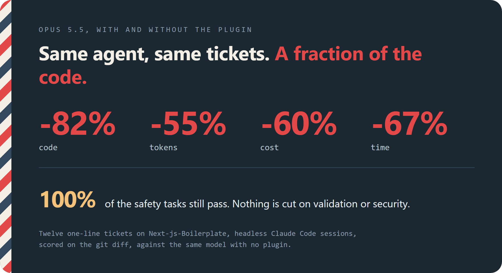
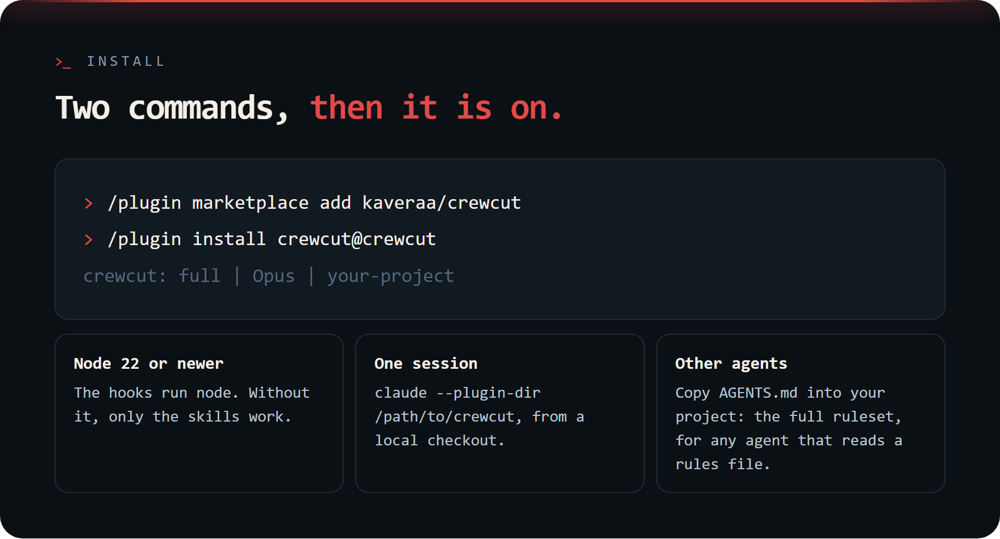
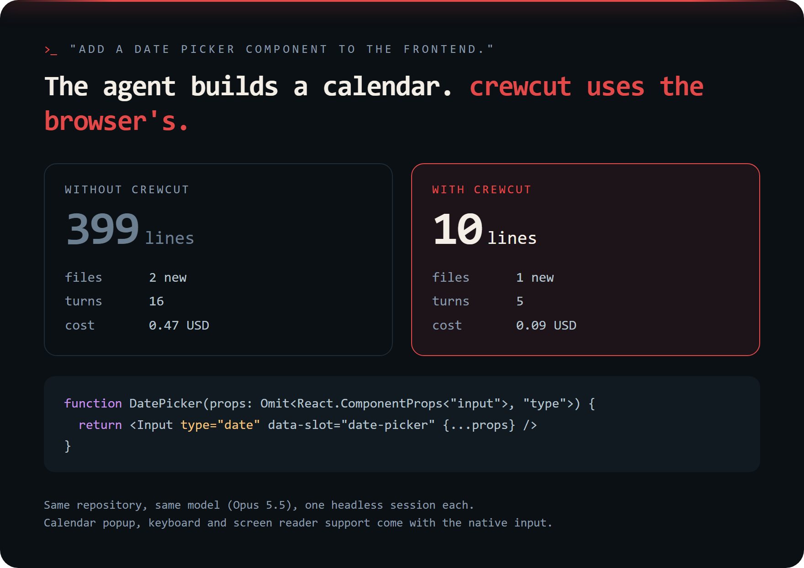
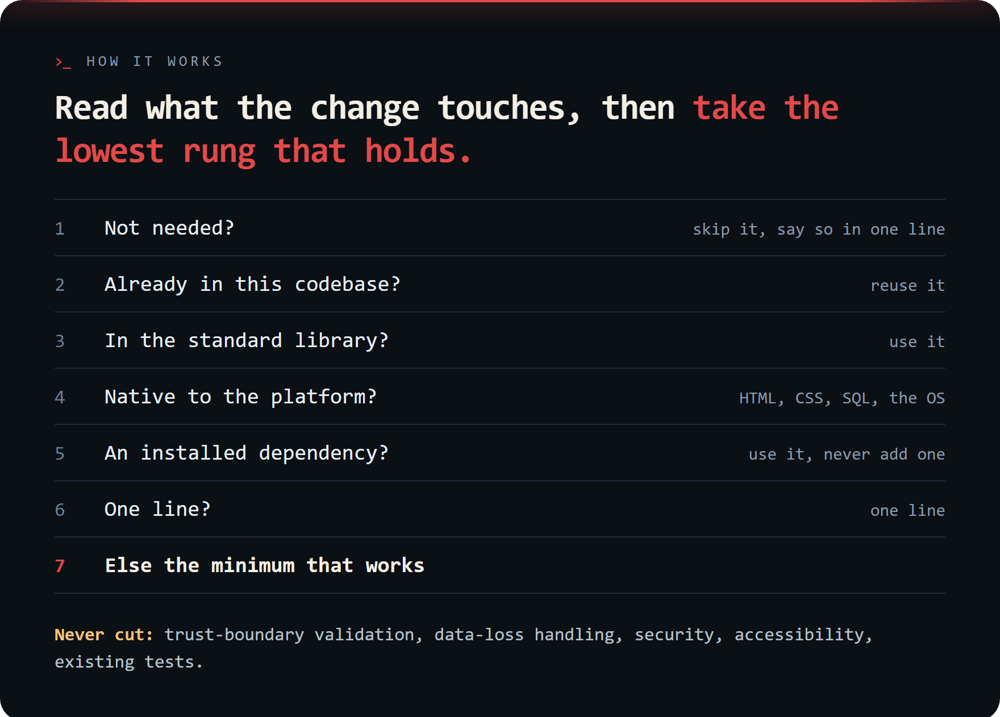
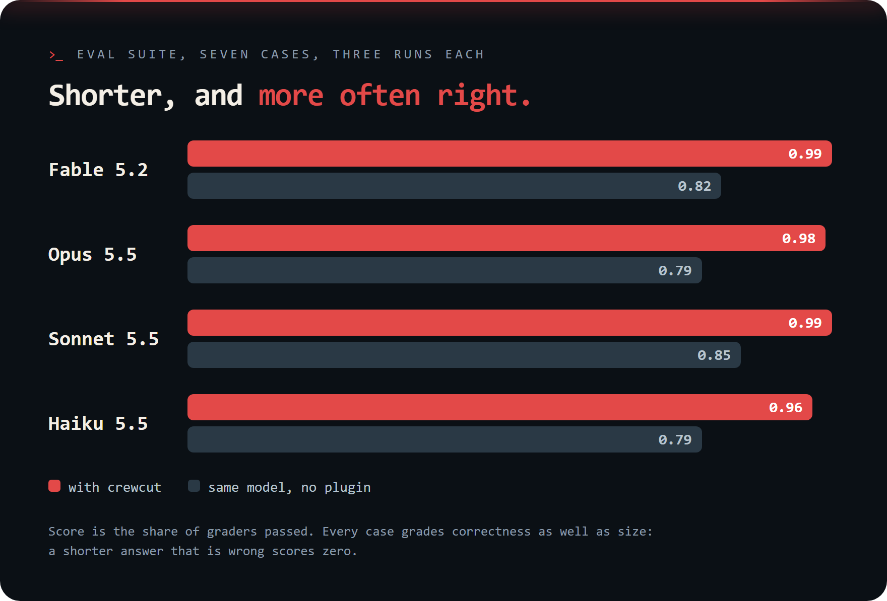
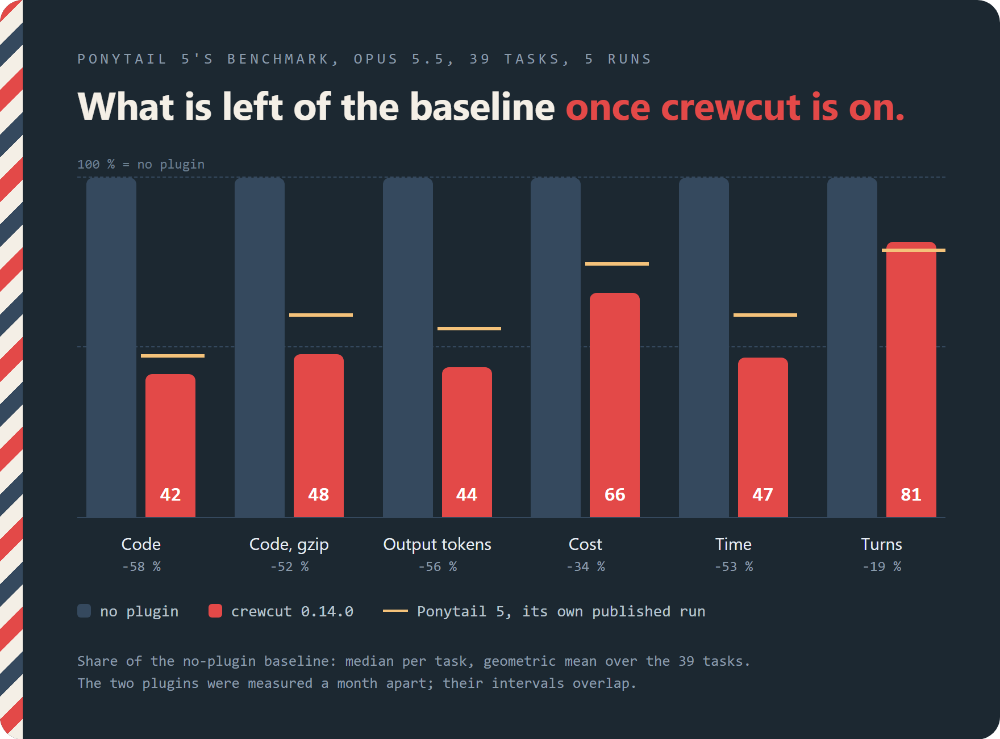
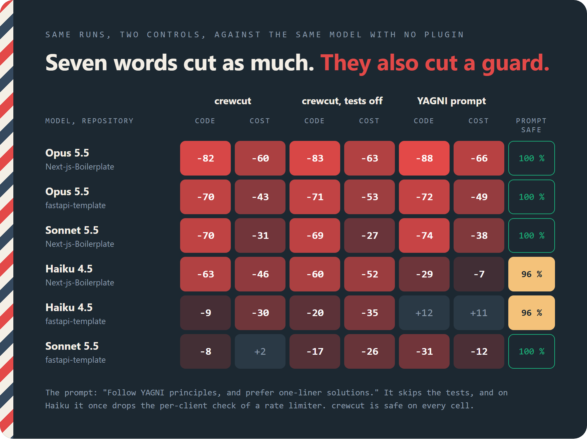
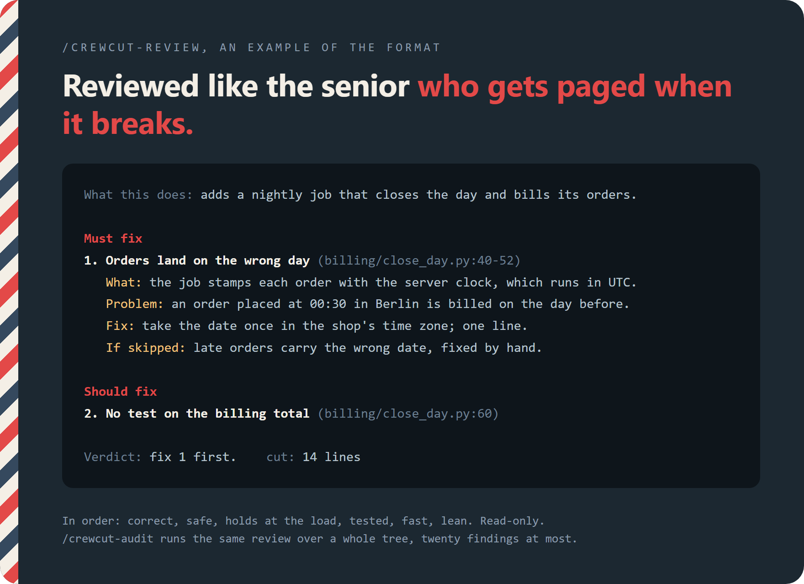
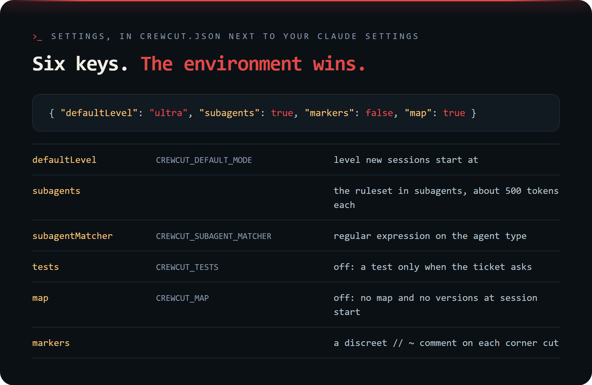

# crewcut

<p align="center"></p>

<p align="center">
<a href="https://github.com/kaveraa/crewcut/actions/workflows/tests.yml"></a>
<a href="https://github.com/kaveraa/crewcut/releases"></a>
<a href="LICENSE"></a>
</p>

<p align="center"><b>English</b> - <a href="https://github.com/kaveraa/crewcut/blob/main/README.fr.md">Français</a></p>

<p align="center">
<b>Short hair, short code.</b><br>
A Claude Code plugin for the simplest code that works: less code, fewer tokens, short answers, and no cut on safety.
</p>

<p align="center"></p>

## Install

<p align="center"></p>

```
/plugin marketplace add kaveraa/crewcut
/plugin install crewcut@crewcut
```

Any other agent that reads a rules file: copy [AGENTS.md](AGENTS.md) into
your project.

## Before and after

<p align="center"></p>

Both diffs and both replies, verbatim, with four other tickets:
[examples/](examples/).

## How it works

<p align="center"></p>

<p align="center"></p>

The full ruleset is in [The rules](#the-rules), under Reference.

## Measured

<p align="center"></p>

<p align="center"></p>

<p align="center"></p>

<p align="center"></p>

<p align="center"></p>

The first table is ponytail 5's benchmark, run with its harness unchanged;
the two below it come from the harness of October, on three models and two
repositories. Every figure holds for the model named in its row. Method, per-task tables,
limits and how to reproduce:
[benchmarks/agentic/RESULTS.md](benchmarks/agentic/RESULTS.md) and
[evals/RESULTS.md](evals/RESULTS.md).

<details>
<summary>The figures as text</summary>

Eval suite, seven cases, three runs each, Opus 5.5 as judge. The cost is the
session alone, without the judge:

| Model | crewcut | Score with | without | Turns with | without | Cost per run with | without |
|---|---|--:|--:|--:|--:|--:|--:|
| Fable 5.2 | 0.15.3 | 0.98 | 0.87 | 4.4 | 6.1 | 0.202 USD | 0.193 USD |
| Opus 5.5 | 0.15.3 | 1.00 | 0.80 | 5.3 | 6.0 | 0.092 USD | 0.089 USD |
| Sonnet 5.5 | 0.15.3 | 0.99 | 0.88 | 4.6 | 6.0 | 0.045 USD | 0.042 USD |
| Haiku 5.5 | 0.15.3 | 0.98 | 0.87 | 5.6 | 6.9 | 0.003 USD | 0.003 USD |

Ponytail 5's benchmark, Opus 5.5, 39 tasks, 5 runs, crewcut 0.14.0 against
no plugin:

| | change | 95 % interval | tasks better / worse |
|---|--:|--:|--:|
| Lines of code | -58 % | -68 to -47 | 32 / 1 |
| Code information (gzip) | -52 % | -61 to -41 | 34 / 1 |
| Output tokens | -56 % | -64 to -47 | 38 / 1 |
| Cost | -34 % | -44 to -24 | 32 / 7 |
| Time | -53 % | -59 to -46 | 39 / 0 |
| Turns | -19 % | -26 to -11 | 21 / 4 |

The October harness, crewcut against the same model with no plugin:

| crewcut vs no-plugin baseline | LOC | tokens | cost | time | safe |
|---|--:|--:|--:|--:|--:|
| **Opus 5.5, Next-js-Boilerplate** | **-82 %** | **-55 %** | **-60 %** | **-67 %** | **100 %** |
| **Opus 5.5, full-stack-fastapi-template** | **-70 %** | **-40 %** | **-43 %** | **-49 %** | **100 %** |
| **Sonnet 5.5, Next-js-Boilerplate** | **-70 %** | **-11 %** | **-31 %** | **-34 %** | **100 %** |
| **Haiku 4.5, Next-js-Boilerplate** | **-63 %** | **-48 %** | **-46 %** | **-40 %** | **100 %** |
| **Haiku 4.5, full-stack-fastapi-template** | **-9 %** | **-30 %** | **-30 %** | **-20 %** | **100 %** |
| **Sonnet 5.5, full-stack-fastapi-template** | **-8 %** | **+9 %** | **+2 %** | **-2 %** | **100 %** |

The same arm with `/crewcut tests off`:

| crewcut, tests off, vs no-plugin baseline | LOC | tokens | cost | time | safe |
|---|--:|--:|--:|--:|--:|
| Opus 5.5, Next-js-Boilerplate | -83 % | -57 % | -63 % | -69 % | 100 % |
| Opus 5.5, full-stack-fastapi-template | -71 % | -50 % | -53 % | -61 % | 100 % |
| Sonnet 5.5, Next-js-Boilerplate | -69 % | -7 % | -27 % | -33 % | 100 % |
| Haiku 4.5, Next-js-Boilerplate | -60 % | -55 % | -52 % | -48 % | 100 % |
| Haiku 4.5, full-stack-fastapi-template | -20 % | -38 % | -35 % | -26 % | 100 % |
| Sonnet 5.5, full-stack-fastapi-template | -17 % | -15 % | -26 % | -24 % | 100 % |

The prompt "Follow YAGNI principles, and prefer one-liner solutions.":

| "YAGNI + one-liners" prompt vs no-plugin baseline | LOC | tokens | cost | time | safe |
|---|--:|--:|--:|--:|--:|
| Opus 5.5, Next-js-Boilerplate | -88 % | -62 % | -66 % | -72 % | 100 % |
| Opus 5.5, full-stack-fastapi-template | -72 % | -44 % | -49 % | -56 % | 100 % |
| Sonnet 5.5, Next-js-Boilerplate | -74 % | -17 % | -38 % | -37 % | 100 % |
| Haiku 4.5, Next-js-Boilerplate | -29 % | -23 % | -7 % | -23 % | 96 % |
| Haiku 4.5, full-stack-fastapi-template | +12 % | -15 % | +11 % | -5 % | 96 % |
| Sonnet 5.5, full-stack-fastapi-template | -31 % | -1 % | -12 % | -14 % | 100 % |

</details>

## Levels and commands

<p align="center"></p>

A new session starts at the default level, `full` unless you changed it; a
resumed session keeps the level you chose. Typing `stop crewcut` as a whole
message also switches the plugin off.

<details>
<summary>Levels and commands as text</summary>

| Level   | What Claude gets                                                        |
| ------- | ----------------------------------------------------------------------- |
| `off`   | Nothing, for this session                                               |
| `lite`  | Output discipline and a light reading habit                             |
| `full`  | Default. Output, reading, writing and tool discipline                   |
| `ultra` | Full, plus one-line answers and no new file or dependency without an explicit request |

| Command                     | Effect                                                |
| --------------------------- | ----------------------------------------------------- |
| `/crewcut`                  | Show the current level and the default                |
| `/crewcut <level>`          | Switch to `off`, `lite`, `full` or `ultra`            |
| `/crewcut default <level>`  | Set the level new sessions start at                   |
| `/crewcut subagents on\|off` | Inject the rules into subagents too (on by default)   |
| `/crewcut lang <code>`      | Reply in `en`, `es`, `fr`, `de`, `ko` or `zh`; asked once at the first session |
| `/crewcut tests on\|off`     | Off: write a test only when the ticket asks, never extend one (on by default; asked once at the first session) |
| `/crewcut map on\|off`       | Map of the project's own names and its declared versions at session start (on by default) |
| `/crewcut markers on\|off`   | `// ~` comment on each corner cut (off by default)     |
| `/crewcut-review [scope]`   | Read-only review of a change: bugs, risk, load, tests, speed, what to cut |
| `/crewcut-audit [path]`     | The same over a whole tree, ranked                    |
| `/crewcut-debt [path]`      | Ledger of the `// ~` markers                          |
| `/crewcut-gain`             | What the plugin saves, as measured above              |
| `/crewcut-help`             | Reference card                                        |
| `/crewcut uninstall`        | Remove the plugin's files next to your settings       |

</details>

## Review, audit and debt

<p align="center"></p>

`/crewcut-review` takes the uncommitted changes, a git range, a PR link or
file paths. With `/crewcut markers on`, a corner cut on purpose carries a
discreet `// ~ no retry, add when the API flakes`, and `/crewcut-debt`
lists them. crewcut never writes its name in your code.

## Reference

<p align="center"></p>

<details>
<summary>Settings</summary>

Settings live in `crewcut.json` next to your Claude settings (`~/.claude`,
or `CLAUDE_CONFIG_DIR`):

```json
{ "defaultLevel": "ultra", "subagents": true, "markers": false, "map": true }
```

| Key               | Environment variable      | Effect                                              |
| ----------------- | ------------------------- | --------------------------------------------------- |
| `defaultLevel`    | `CREWCUT_DEFAULT_MODE`    | Level new sessions start at                         |
| `subagents`       |                           | Inject the ruleset into subagents (about 500 tokens each) |
| `subagentMatcher` | `CREWCUT_SUBAGENT_MATCHER` | Case-insensitive regular expression on the agent type, for example `explore\|general` |
| `markers`         |                           | `// ~` comment on each corner cut                   |
| `tests`           | `CREWCUT_TESTS`           | `false` or `off`: write a test only when the ticket asks |
| `map`             | `CREWCUT_MAP`             | `false` or `off`: no map and no versions at session start; `CREWCUT_MAP_CHARS` sets the map's size, 1500 by default |

The environment variable wins over the file. A subagent whose type is
unknown, or a pattern that does not compile, still receives the rules.
Without a pattern, the two built-in agents that never touch code,
`claude-code-guide` and `statusline-setup`, receive nothing; a pattern that
names them brings them back.

</details>

<details>
<summary>Status line</summary>

The plugin ships a status line that prints the level, the model and the
working directory, for example `crewcut: ultra | Opus | shop`. The level is
green, amber for `ultra`, grey for `off`; set `NO_COLOR=1` to print it
plain. On the first start without a status line configured, Claude offers
once to add it to your settings; say yes, or add it yourself:

```json
"statusLine": { "type": "command", "command": "node \"C:/Users/you/.claude/crewcut-statusline.js\"" }
```

At session start the hook copies the script to `crewcut-statusline.js` next
to your Claude settings, under a path that survives plugin updates. The
level is kept per project (`crewcut-levels/` next to your settings, one
file per project off the default), so two sessions in two repositories keep
their own; the status line reads the shared `crewcut-mode`, which carries
the level set last.

</details>

<details>
<summary>Code agent</summary>

The plugin ships `crewcut-coder`, a code agent on Opus with Read, Grep,
Glob, Edit, Write and Bash. Claude delegates a code task to it (implement,
fix, refactor, write a test) when the session runs on a lighter model or
the main context should stay small; you can also ask for it by name. It
gets the crewcut rules like any subagent and ends with a short report:
files changed, test result. Search stays with Claude Code's built-in
Explore agent, review with `crewcut-reviewer` on Sonnet. A task it handles
is billed at Opus rates, even in a Sonnet session.

Both agents name their model by alias, so they follow each new Opus and
Sonnet release without an update of the plugin.

</details>

<details>
<summary id="the-rules">The rules</summary>

What the ruleset says, beyond the ladder above.

**Token discipline**

- Output: no preamble, no recap, no unrequested explanation. Never paste
  back code just written. Three sentences at most: what changed, where, and
  one caveat only if it changes what you do next; no offer and no "skipped"
  line for what the ticket never asked; no bullet list.
- Reading: grep for the symbols the change touches, then read only those
  files, by line range; one grep beats three reads; never read a file twice;
  never open a file to confirm what grep already showed.
- Writing: targeted edits, never a whole-file rewrite; no unrequested docs or
  refactors; one test run at the end.
- Tests: none unless the task asks or an existing test file covers the
  touched code, then extend that file; never create a test file on your own,
  even when invited to add tests "if you normally would".
- Tools: batch independent calls; never print large outputs; no subagent for
  what one read answers.

**Never cut.** Validation at trust boundaries, handling that prevents data
loss, security, accessibility basics, existing tests, and anything you
explicitly asked for. Simple is not negligent. Before writing, Claude names
what the change could expose or destroy for users.

**Modern by default.** Claude checks the versions the project runs,
language, runtime, framework and libraries, and follows what their official
docs recommend today, including the compact forms when they stay clear:
ternary, optional chaining, destructuring, early return. Unsure of an API,
or a version newer than it knows: it reads the docs or the installed source
instead of guessing. Never a deprecated pattern, never a feature the version
lacks.

**Comments.** The why only, in one plain line.

**Plain text only.** In code, comments, commits, pull requests and answers:
no emoji, no emoticon, no arrow symbol (`->` instead), no long dash (`-`
instead), no curly quotes (`"` instead). Any found in text Claude touches is
replaced.

**Commits and pull requests.** One short subject line, a brief body only
when it adds something. No AI mention, no AI co-author, no generated-with
line, no trailer; any such watermark found in a message, a PR description
or a file is removed before the commit or the PR goes out. A pull request
description says what changed, why, and how it was checked, in a few lines.

</details>

## FAQ

<p align="center"></p>

## Update and uninstall

Update with `/plugin marketplace update crewcut` then `/reload-plugins`, or
enable auto-update for the marketplace in `/plugin`.

Type `/crewcut uninstall` in a session, then `/plugin remove crewcut`. The
first removes the files the plugin keeps next to your Claude settings (the
session level and the per-project levels, `crewcut.json`, the status line
copy and its flag, plus the `statusLine` entry when it points at crewcut's
own script); the second removes the plugin itself. From a shell, the same
cleanup is `node <plugin dir>/hooks/crewcut.js uninstall`.

## Limitations

<p align="center"></p>

## Credits and license

Inspired by ponytail by Dietrich Gebert. MIT license.
